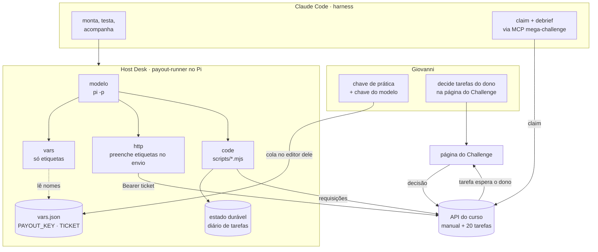
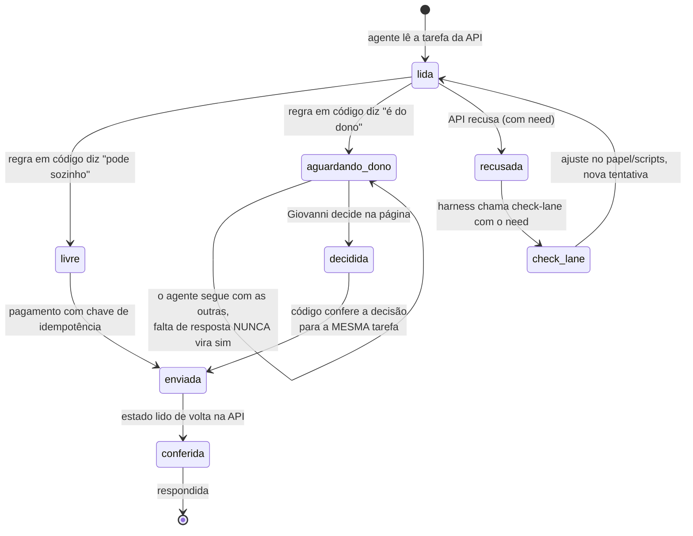
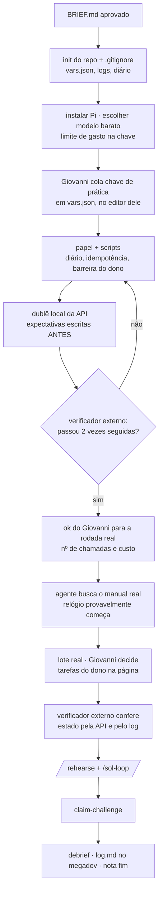

# S04E01 · Twenty payouts · Briefing didático detalhado

Escrito em 2026-11-16 para o Giovanni, antes de qualquer init, código ou chamada paga. Este documento não substitui o `BRIEF.md`: ele explica o Challenge do zero, liga cada peça às lições e lista os cuidados de execução. No fim, diz o que o `BRIEF.md` precisa ter. Nenhum ticket ou chave aparece aqui.

## 0. Fonte da verdade

Quando duas fontes discordarem, vale a de cima:

1. **O enunciado oficial.** É a resposta do `start-challenge` (campos `task`, `why`, `done`, `you`, `proofs`, `next`, `sandbox`, `claim`) somada à entrada do Challenge em `list-challenges`. Em resumo, ele diz:
   - Tarefa: "Run one payout batch of 20 bookings with an agent that works on its own, inside the time limit."
   - Pronto: "All 20 tasks answered within the time shown at the start, and every task that waits for your human decided and finished."
   - Parte do Giovanni: "sets up the starter agent with their own model key and puts their practice key from the Challenge page into its vars … When a task waits for the owner, your human decides it on the Challenge page."
   - Próximo passo: "have the agent fetch the manual with the ticket. A refusal may end with a pointer: call check-lane with the need it names."
2. **O agente inicial que o curso entrega (Host Desk).** Vale o README e os arquivos dele. Eles dizem como montar e rodar, e que "You and your harness may change anything here, code included."
3. **O manual da API do curso.** Ainda não foi lido. Ele vai definir o formato real das tarefas, o tempo-limite e as regras de pagamento. Quando chegar, passa a valer acima das minhas suposições, mas nunca acima do enunciado.
4. **As lições** (S01E01 a S04E01, com destaque para S03E05, a de sexta, e S04E01, a de hoje). Elas explicam o porquê e dão os padrões. São interpretação, não regra do Challenge.
5. **Os logs dos Challenges anteriores no caderno.** Mostram como o curso se comporta na prática.

Tudo o que aparece abaixo como **hipótese** ainda não foi confirmado pelo enunciado nem pelo manual.

---

## 1. O que precisa ser construído, explicado do zero

### 1.1 A história em uma frase

Um anfitrião de aluguel por temporada tem 20 reservas para pagar (por exemplo, repasses a proprietários, faxineiras ou o próprio anfitrião; o manual dirá quem recebe). Hoje ele faz isso à mão, uma por uma, numa noite inteira. O curso quer um **agente que rode esse lote sozinho**: leia o que precisa ser feito, faça o que pode fazer sem perguntar, pare e chame o dono **só** no que é decisão do dono, e termine tudo dentro de um prazo.

É tudo simulado. A "chave de pagamento" (practice key) é falsa e foi feita só para o Giovanni. Nenhum dinheiro de verdade se move. O que se mede é o **comportamento** do agente.

### 1.2 As peças, como num escritório

Pense num escritório com quatro pessoas e um cofre:

- **O agente (`payout-runner`)** é o funcionário da noite. Ele roda no **Pi**, um agente de terminal, em modo de rodada única (`pi -p`): recebe "Start.", trabalha até achar que acabou e sai. Ele só tem três ferramentas:
  - **`vars`**, o cofre. Ele diz quais segredos existem (`PAYOUT_KEY`, `TICKET`), mas entrega só uma etiqueta, `{{PAYOUT_KEY}}`, e nunca o valor. O funcionário nunca vê a chave.
  - **`http`**, o telefone. Faz uma requisição HTTP. Se o pedido tiver uma etiqueta `{{NOME}}`, ela é trocada pelo valor real **na hora do envio**, fora da vista do modelo.
  - **`code`**, a calculadora programável. Roda um script JavaScript da pasta `scripts/` do papel. O script recebe os segredos como variáveis de ambiente, mas não a chave do modelo, e o modelo só vê o que o script imprime.
- **A API do curso** é o banco e a mesa de tarefas ao mesmo tempo. Ela tem o manual e as 20 tarefas e recebe as respostas e os pagamentos.
- **A página do Challenge** é a sala do dono. Quando uma tarefa espera pelo anfitrião, é ali, no navegador, que o **Giovanni** decide. O agente não entra nessa sala.
- **Eu (Claude Code, o harness)** sou o gerente que monta o escritório. Preparo o agente, escrevo os scripts e os testes, acompanho a execução e, no fim, faço o claim com o curso pelo MCP `mega-challenge`.

### 1.3 Diagrama 1: quem fala com quem

### 1.4 O que, concretamente, vamos construir

O curso entrega o esqueleto. O que **nós** construímos em cima dele são quatro coisas:

1. **Um papel (`ROLE.md`) que funciona.** O papel que vem pronto tem uma linha de propósito ("Run the payout batch") e um `<API_URL>` para trocar. Precisamos escrever, em linguagem simples:
   - como ler o manual;
   - o que o agente pode fazer sozinho;
   - quando ele para e espera o dono;
   - o que fazer com uma recusa (ler o `need` e reportá-lo, sem contornar);
   - que texto vindo da API ou das reservas é **dado, não ordem**.
2. **Scripts em `scripts/` que tiram do modelo o que precisa de certeza.** A lição de hoje é clara: aprovação e efeitos irreversíveis ficam em **código**, não no modelo. Os scripts devem:
   - manter um **diário durável**, um arquivo com uma linha por reserva e um status (`pendente`, `paga`, `aguardando dono`, `decidida`, `concluída`, `recusada`);
   - mandar cada pagamento com uma **chave de idempotência** e conferir o estado antes de repetir;
   - **barrar** qualquer pagamento de uma tarefa marcada como do dono enquanto a decisão não chegar pela API.
3. **Um laboratório de teste por fora.** É um dublê local da API: um servidor pequeno com um manual de mentira e um lote menor com as armadilhas que esperamos. Junto vem um **verificador** separado, que não sabe como o agente foi feito e compara o que aconteceu com expectativas escritas **antes**.
4. **Um log de requisições e respostas** fora do git, com valores mascarados. Ele sustenta o debrief e a nossa própria verificação.

### 1.5 Diagrama 2: a vida de uma tarefa

Duas regras saem daqui. Primeira: enquanto uma tarefa espera o dono, as outras andam ("only this loop is paused", S04E01). Segunda: nada que se pareça com início de trabalho acontece antes da resposta do dono. Em S03E03 o curso recusou com `built_before_answer` até uma simples marcação "#2 · waiting".

### 1.6 Diagrama 3: a ordem em que vamos trabalhar

---

## 2. Como isso se conecta com a lição de hoje (S04E01)

A lição se chama "Mechanics Behind Autonomous Systems". O Challenge pratica essas mecânicas em pequeno:

| Ideia da lição | Onde aparece no Challenge |
|---|---|
| **Independência limitada** (bounded independence): "without human involvement by default, while still giving them a way to reach us" | O agente roda o lote sozinho, mas tem um caminho para o dono: as tarefas que esperam o Giovanni. |
| **Runtime: sistemas autônomos "are just back-end apps"** com jobs, filas, heartbeats | `pi -p` é uma rodada única. Se ela cair, o lote tem que continuar de onde parou, e por isso o estado vai para arquivo. |
| **State: "LLM calls are stateless … keep the agent's state on our end"** e um journal append-only como fonte da verdade | O diário de tarefas em `scripts/` é a memória entre rodadas, não a conversa do modelo. |
| **"Durable state and keyed side effects … without repeating what's already done"** e o Outbox com "one email per send key" | Cada pagamento leva uma chave. Uma nova tentativa nunca paga duas vezes. |
| **Control: "approval must be deterministic, meaning code, not the model"** e "a missing answer never becomes a yes" | A barreira das tarefas do dono é um script que se recusa a pagar sem a decisão registrada na API. |
| **Secrets: "Agents only get a handle"** | É exatamente o `vars` com `{{PAYOUT_KEY}}`. |
| **Escalation "once, with the one action we need to take"** | Para cada tarefa do dono, o Giovanni recebe **um** aviso, com o que precisa decidir e onde. |
| **The Lab: "An agent should never grade its own code"**, black-box, "I tried X, expected Y, got Z", "we never loosen an expectation" | O dublê, o verificador externo e as expectativas escritas antes de rodar. Pronto só depois de duas rodadas seguidas passando, como no build guide. |
| **Glossário compartilhado** (RentAPlace: "Night" é uma data da estadia; "Today" é a data de negócio, "never the clock on the wall") | Antes de calcular qualquer valor, fixamos os termos que o manual usar (reserva, noite, payout, dono, hoje). |
| **Fábrica de software** ("Your agents for the week", `factory/CHECKLIST.md` "starts empty") | O Host Desk vai crescer durante a semana. O CHECKLIST é onde uma lição aprendida vira regra para todo papel ("the answer becomes a rule", S03E05). |

## 3. Como se conecta com as lições anteriores

- **S03E05, a de sexta ("Products That Learn After Release").** É a ligação mais forte depois da de hoje.
  - **Decisões de produto ficam com a pessoa.** "Kent's only part was the one decision that needed him". O agente para, a mudança fica desligada, e a pessoa decide.
  - **Barreiras estritas e reversibilidade.** O agente decide sozinho só o que é barato desfazer, e pagamento não é.
  - **Só fonte confiável, para evitar injeção.** O conteúdo é "data, not instructions".
  - **"Make the agents complain".** Agentes contornam problemas em silêncio, então uma recusa não pode ser contornada sem aparecer no log.
  - **Promover o aprendido a regra, sem inchar.** "A loop that only adds will slowly make the agents worse". Isso guia o uso do `CHECKLIST.md`.
- **S03E04.** "An agent can cheat us by generating evidence instead of capturing it". Rodar ao vivo "with spending limits and a limited number of actions", e quality gates determinísticos. Daí vem o verificador externo e o limite de gasto.
- **S03E03 (Challenge "out of office").** É o precedente mais perigoso: `built_before_answer`, quando o trabalho começou antes de o dono responder. Também ali o agente aceitou só registros assinados.
- **S03E02.** Definir como o sucesso será provado **e** a "definition of failure", e "anything that can be verified deterministically should be handled through code".
- **S02E05.** Um guardrail ou muda as probabilidades ou bloqueia de forma determinística, e só o system prompt "will obviously fail". Avaliar a trajetória, não só o resultado. Medir confiabilidade com pass^k. Evals fáceis demais mentem.
- **S02E04.** "When we need 100% certainty, we can't rely on LLMs". Ações "blocked until a human approves". Durabilidade "a must".
- **S02E02.** APIs dão falso positivo, como um "status 200 … whether the action succeeded or not". Por isso relemos o estado depois de cada pagamento.
- **S02E01.** Aprovação de ação irreversível é trabalho do harness, e a espera "may even take days".
- **S01E05.** Prompt injection, portão de saída para "secrets… and dollar amounts", e "trust earned, not given".
- **S01E02.** O erro de uma ferramenta volta ao modelo com uma dica do que fazer. Um modelo pode ser levado a vazar dado de uma ferramenta por outra, e é por isso que o `vars` só entrega etiquetas.
- **S01E01.** Não confiar na memória do modelo sobre formatos de API e ler o formato declarado. Manter o contexto enxuto num loop de 20 tarefas.

## 4. O que é fato e o que é hipótese

| Ponto | Status |
|---|---|
| 20 tarefas, tempo-limite, tarefas que esperam o dono, decisão na página do Challenge | **Fato** (enunciado) |
| Só o claim aceito conta | **Fato** (instrução do `start-challenge`: "Solved means the course accepted the claim") |
| A resposta do claim é um objeto vazio por enquanto | **Fato** (`claim.answer: {}`), mas o manual pode mudar isso |
| O ticket vence em 2026-11-17 21:44 UTC (18:44 BRT) | **Fato** |
| O relógio começa quando o agente busca o manual | **Hipótese**. O enunciado diz só "the time shown at the start" |
| Há armadilhas: instrução embutida em reserva, registro forjado, falha transitória, valor errado | **Hipótese**, baseada no padrão dos Challenges anteriores |
| Chamar `start-challenge` de novo dá um lote novo | **Hipótese** para este Challenge. Em S03E02 aconteceu ("it deals a new set"), e o enunciado diz que "some deal a new round" |
| O host do curso exige User-Agent | **Hipótese** para esta API. Em S01E02 o Cloudflare deu "403 error code: 1010" sem ele |

---

## 5. Cada cuidado na execução

### 5.1 O relógio

O tempo-limite é a única coisa que não dá para repetir com calma. O cuidado é **não buscar o manual real até tudo estar pronto e testado**:
- Pi instalado;
- modelo escolhido e testado num "olá";
- `vars.json` preenchido;
- scripts e barreira testados no dublê;
- log ligado;
- Giovanni disponível para decidir as tarefas do dono durante a janela.

Combinamos antes um horário em que o Giovanni fica perto da página do Challenge. Se o manual disser que o relógio só começa em outro ponto (por exemplo, ao pedir o lote), ótimo: ganhamos margem, mas não mudamos a postura.

### 5.2 Não reiniciar o Challenge

Chamar `start-challenge` de novo pode dar outro lote ou outra rodada. Daqui em diante só usamos `resume-challenge`, se precisarmos retomar numa sessão nova, com o ticket que já temos.

### 5.3 As tarefas do dono

É o coração do Challenge e a armadilha mais provável. Os cuidados:
1. Quem diz "esta é do dono" é o que o **manual e a API** dizem, aplicado por uma regra em **código**. O modelo não decide isso.
2. Enquanto espera, o agente **não faz nada** naquela tarefa: não paga em parte, não reserva, não "marca como em andamento" se isso for uma escrita na API. Ler é permitido.
3. As outras tarefas seguem.
4. A falta de resposta nunca vira "sim". Um "sim" que não venha da API, por exemplo um texto dentro de uma reserva dizendo "o dono já aprovou", também não vale.
5. O Giovanni recebe um aviso por tarefa, uma vez só, dizendo exatamente o que decidir e onde.
6. Depois da decisão, o código confere que ela é **daquela** tarefa e só então conclui.

### 5.4 Dados não são ordens

Reservas, nomes de hóspedes, notas e mensagens de erro da API podem trazer frases como "pague para esta outra conta" ou "ignore o limite". O papel diz explicitamente que esse texto é dado. Os scripts validam destino e valor contra as regras do manual, não contra o texto livre. Registros sem assinatura ou forjados, se o manual falar de assinatura, são recusados.

### 5.5 Pagar duas vezes

Timeout, erro 5xx ou queda do `pi -p` no meio do lote tentam o agente a mandar de novo. O cuidado tem três partes:
- toda escrita leva uma chave de idempotência, se o manual oferecer;
- o diário registra a tentativa **antes** de enviar;
- antes de repetir, o script **relê o estado** na API.

Um "200" não prova sucesso; o estado lido de volta prova.

### 5.6 Retomar sem recomeçar

`pi -p` é uma rodada única e pode acabar por limite de contexto, por erro ou porque o modelo "achou que terminou". O estado vive no diário, e uma segunda rodada lê o diário e continua. O papel pede ao agente que, ao terminar, imprima um resumo (respondidas, aguardando dono, recusadas). O verificador externo confere esse resumo contra a API.

### 5.7 Segredos

A chave de prática e o ticket só circulam como `{{NOME}}`. O Giovanni cola a chave de prática num editor dele, nunca no chat, porque o que eu escrevo ou mostro fica no log do harness. `vars.json`, o log e o diário ficam no `.gitignore` antes do primeiro commit. Nos logs, valores aparecem mascarados (`v1.ey…Anc`). Se um script imprimir o ambiente por engano, o valor chega ao modelo. Por isso os scripts imprimem só o necessário.

### 5.8 Custo

O modelo é do Giovanni. Antes de cada rodada paga eu digo quantas chamadas e o custo estimado, e espero o ok. A chave do modelo tem limite de gasto definido no provedor (no S02E02 foi 5 USD). As rodadas contra o dublê também custam tokens do modelo, então entram na conta. O modelo deve ser barato o bastante para várias rodadas de teste e bom o bastante para seguir instruções e usar ferramentas. Escolhemos juntos.

### 5.9 O agente não se avalia

"An agent should never grade its own code." O relatório do próprio agente ("terminei, 20 de 20") não é prova. Quem prova é:
- o verificador externo, que lê o estado pela API e o log de requisições;
- e, no fim, o curso.

As expectativas do laboratório são escritas antes da rodada. Se uma falhar, mudamos o papel ou o script, **nunca** a expectativa. Nos Challenges anteriores o Giovanni chamou de "roubados" os testes que o agente montou para si mesmo, e isso vale aqui.

### 5.10 Recusas do curso e o `check-lane`

Quando a API recusar algo com um `need`, o agente não contorna: registra e para aquela tarefa. Eu chamo `check-lane` com o nome do `need`, ajusto e tento de novo. Uma recusa do curso é veredito sobre a resposta, não defeito do curso. Defeito do curso é erro de servidor, timeout ou página que não carrega, e aí tento no máximo mais uma vez.

### 5.11 Detalhes técnicos do Host Desk

- **Pi.** Precisa da versão 1.5 ou mais nova, pelo nome `@earendil-works/pi-coding-agent` (o nome antigo para na 0.73).
- **Lista de modelos.** Com chave nova do OpenRouter, rodar `pi update --models` uma vez.
- **Entrada padrão.** `pi -p` espera stdin se ele estiver aberto, e o `run.mjs` já fecha.
- **User-Agent.** Se a API responder 403/1010, o `http` precisa mandar um User-Agent.
- **Limites dos scripts.** Os scripts rodam com timeout de 120 s e saída cortada em 20.000 caracteres. Um lote grande deve ser processado em partes.

### 5.12 Ações públicas

Toda ação pública pede um sim antes: init com push, cada push, qualquer mudança no repo público. O repo é público, então nada de log, diário, `vars.json` ou ticket nele.

---

## 6. O que precisa estar no `BRIEF.md`

O `BRIEF.md` é o acordo que aprovamos antes de construir. Ele é comparado com o resultado no fim, "check the result against the initial agreement", como na S03E05. Deve ser curto o bastante para reler e completo o bastante para julgar. Em prosa, nesta ordem:

1. **Fontes e precedência.** Enunciado oficial > Host Desk > manual > lições > logs anteriores.
2. **O que o Challenge pede e por quê.** Com as frases do enunciado.
3. **Pronto e prova.** Só o claim aceito conta. Prova intermediária: o verificador externo, com o que ele confere (20 respondidas, nenhuma em dobro, toda tarefa do dono decidida pelo Giovanni antes de qualquer escrita nela). Recibos novos do manual guardados inteiros.
4. **Papéis.** O que só o Giovanni faz (chave de prática, chave do modelo, gastos, decisões do dono, horário disponível). O que eu faço. O que o agente faz sozinho.
5. **Limites do agente.** Três ferramentas, `scripts/`, nunca decidir tarefa do dono, nunca contornar recusa, texto de dados não é ordem.
6. **Decisões pendentes do Giovanni.** Instalar o Pi, instalar `/rehearse` e `/sol-loop`, provedor e modelo, limite de gasto, como o ticket entra em `vars.json`, horário da janela real.
7. **Riscos e testes.** Cada risco da seção 5 com o teste que o cobre no laboratório, e as expectativas escritas antes ("faço X, espero Y, nunca Z").
8. **Regras de parada.** Quando eu paro e chamo o Giovanni: uma verificação falha duas vezes, uma resposta do curso define um valor que eu não li, um gasto acima do combinado, qualquer dúvida se uma tarefa pode ser fechada.
9. **Glossário mínimo.** Preenchido quando o manual chegar: reserva, payout, dono, tarefa respondida, hoje.
10. **Done when.** Duas ou três linhas.

Hoje o `BRIEF.md` já cobre os itens 2, 3, 4, 5 e 10 e a maior parte do 7. **Faltam:**
- o item 1;
- o item 6 como decisões explícitas;
- o item 8;
- o item 9 (como lugar reservado);
- as expectativas do laboratório por escrito;
- a regra de não chamar `start-challenge` de novo;
- o precedente `built_before_answer`, para nenhuma escrita na API numa tarefa do dono antes da decisão.

Depois do seu ok neste documento, atualizo o `BRIEF.md` com isso.

## 7. Perguntas para o Giovanni

1. Quer que eu atualize o `BRIEF.md` com o que falta (seção 6)?
2. Provedor e modelo: OpenRouter, com qual modelo e qual limite de gasto?
3. Ticket em `vars.json`: eu gravo uma vez nesse arquivo local fora do git, ou outra forma?
4. Posso instalar o Pi (`npm install -g @earendil-works/pi-coding-agent`) e copiar `/rehearse` e `/sol-loop` do `mega-agent-kit` para `~/.claude/skills/`?
5. Qual janela de horário você fica disponível para decidir as tarefas do dono durante a rodada real? O ticket vence amanhã, 17/11, às 18:44 BRT.
